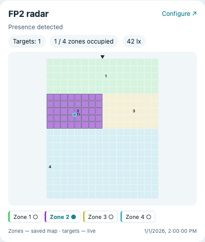

# FP2 Firmware

Local ESPHome firmware and Home Assistant cards for the **Aqara FP2**.
Presence, all 30 native zones and live targets stay on your network.
The original radar signal processing is retained.

| Use | Read |
| --- | --- |
| Open, back up and flash an FP2 | [Installation](docs/install.md) |
| Configure zones and watch targets | [Home Assistant cards](docs/home-assistant.md) |
| Build the radar monitor and acquire flash | [Radar tools](docs/radar.md) |
| Understand the implementation | [Architecture](docs/architecture.md) |
| Implement another client | [Protocol](docs/protocol.md) |
| Follow the evidence and open questions | [Research](docs/research.md) |

```text
Home Assistant ⇄ ESP32 / ESPHome ⇄ TI radar ⇄ radar flash
   cards          this firmware     vendor DSP
                                   + monitor extension
```



*Interface demonstration with synthetic layout data; no household capture.*

## Build

Requires Python 3.13, a C++17 compiler, Node.js 24 and [uv](https://docs.astral.sh/uv/).

```sh
python3 tools/configure.py
npm ci --prefix ha-card
make fast
make firmware
make cards
```

The app is written to `artifacts/fp2-esp32.bin`; the two cards share
`ha-card/dist/fp2-local-card.js`. Follow the installation guide before flashing:
**this is an app-only image, not an image for address zero**.

## Status

Tested on an ESP32-SOLO FP2 with 16 MiB ESP flash and 8 MiB radar flash.
ESP32 OTA, native zone read/write and target reporting have been exercised on
hardware. The monitor has acquired a complete radar flash dump. Exact support
is version-scoped; installers reject unknown layouts and radar bundles.

Learning accuracy, interrupted radar-update recovery and long-term reliability
remain open. Occasional accelerometer read errors are detected rather than
hidden. Fall/sleep operation and vendor-cloud features are outside this release.

No vendor firmware, device backups, credentials or household recordings are
included. Build the radar extension from firmware you obtain from your own unit.
CI builds use disposable credentials and are **not installation images**.

## Acknowledgements

[hansihe/esphome_fp2](https://github.com/hansihe/esphome_fp2) provided the original
FP2 ESPHome work, UART research and illustrated board-access guide that made
this work possible. See [credits and third-party notices](THIRD_PARTY.md).

Project code and documentation: [MIT](LICENSE).
