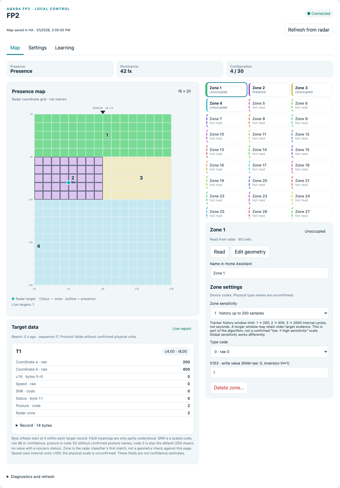

# Home Assistant cards

One JavaScript module provides a full editor and a compact dashboard map.
Both use HA's authenticated ESPHome connection; no backend integration, token
in the bundle or MQTT broker is required.

```sh
npm ci --prefix ha-card
npm --prefix ha-card test
npm --prefix ha-card run build
```

Copy `ha-card/dist/fp2-local-card.js` to
`/config/www/fp2-firmware/fp2-local-card.js`. Add a JavaScript module resource:
`/local/fp2-firmware/fp2-local-card.js?v=1`. Change the version query after updates.

## Shared configuration cache

Create an empty **storage-mode** dashboard with URL `fp2-cache`; hide it from the
sidebar if desired. Both cards store/load configuration observations through
HA's supported Lovelace WebSocket API. Administrators can refresh/save; the compact
card only reads. The dashboard must exist before the first cache save.

```yaml
# Full editor, preferably in its own panel dashboard:
type: custom:fp2-local-card
title: FP2 configuration
node: fp2
entity_prefix: fp2
service_prefix: fp2
cache_dashboard: fp2-cache
```

```yaml
# Add to an ordinary dashboard:
type: custom:fp2-glance-card
title: Presence
node: fp2
entity_prefix: fp2
cache_dashboard: fp2-cache
```

Names above assume the supplied `fp2` device configuration and a new HA
installation. If HA assigned different entity IDs, set `entity_prefix` to the
shared prefix before `_room_presence` / `_native_zone_1_occupancy`. `service_prefix`
is the node's ESPHome action prefix; inspect the available `fp2_read_configuration`
action in Developer Tools. `node` must match the target event's `node` field.

Enable the ESPHome integration's permission for device-initiated HA actions so
`esphome.fp2_targets` events reach the cards. No high-rate sensor per target is
created. Raw target events may still be recorded by HA; disabled diagnostic
entities alone do not suppress event history.

## Workflow

Open the editor and choose **Refresh from radar** once. Thirty zone records,
three special maps and four scalar settings take roughly a minute. Later openings
load the cached configuration immediately. External configuration changes need
an explicit refresh; cached values are labelled as such.

Select a zone, edit its mask/properties and apply explicitly. Drafts can be
cancelled or undone. Success requires fresh matching readback, not just an ACK.
Special maps cover boundaries/exclusions, entries/exits and interference sources.
Learning has explicit prerequisites; it is never started automatically. Individual
false-target deletion is intentionally unavailable because its vendor handler has
an unsafe path. See [protocol](protocol.md).

Live targets and native occupancy remain live; cache data cannot make a stale
track fresh. Track IDs are not person identities, grid cells are not metres and
SNR is not a confidence percentage.

## Language

Both cards follow the Home Assistant language. English is the fallback; Russian
is also included. Set `language: en` or `language: ru` to override per card.
Device-provided names and raw protocol/status values remain intact. Firmware
entity names are English and can be renamed through HA's entity registry.

## Updates and history

Diagnostic/setup entities are disabled by default. Optional diagnostics update
on a slower schedule; illuminance is filtered. Native occupancy and target events
are forwarded immediately. Do not add a general debounce to occupancy merely to
reduce recorder traffic. This project does not install recorder exclusions or
change retention policy.

## Interface preview



*Isolated demonstration using synthetic zones and a target; not a live household capture.*
